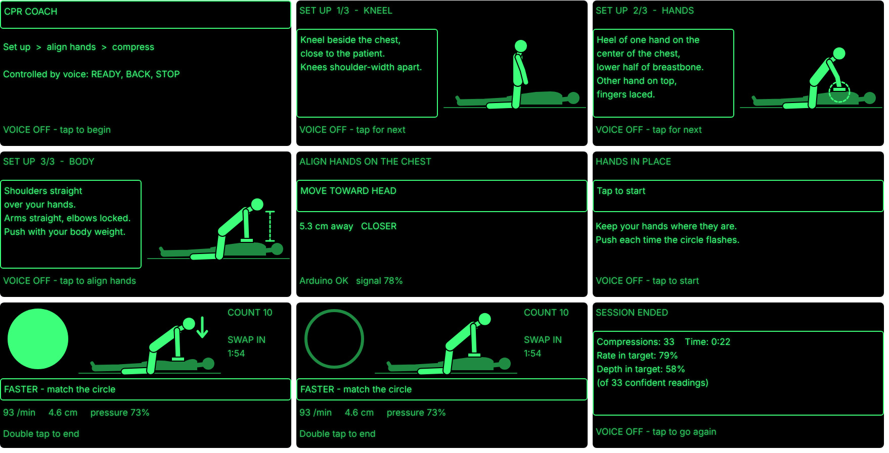

# CPR Coach — G2 glasses app (mock)

Even Realities G2 glasses UI for CPR Coach. **Training tool, not a medical device. Practice on a manikin or pillow only.**

The app currently runs against a **mock Arduino server** (hand position + bracelet compression data), driven from a control panel on the phone / simulator / browser screen.

## Flow



The app is **voice controlled** — the rescuer's hands stay on the chest:

| Say | Does |
|---|---|
| **"READY"** (or "next") | Next step / start compressions |
| **"BACK"** | Previous step |
| **"STOP"** | End the compression session |

Touchpad / ring taps still work as a fallback; the screen only mentions them when voice isn't available (e.g. the speech model is missing), so the rescuer is never stuck.

1. **Splash** — app name, the steps, and the voice commands. Say READY.
2. **Set up (3 pages)** — how to kneel, where to put your hands, how to hold your body, each with a picture of the position (same figure style as the compression animation). Say READY for each page.
3. **Align hands** — hands-free: the Arduino says which way to move (toward head / feet / left / right), how far, and CLOSER / FARTHER. Holding on the spot for 1.5 s moves on by itself. If hand tracking is lost, say READY to continue anyway — a sensor never blocks CPR.
4. **Ready** — say READY to start. If your hands drift off the spot for 1 s you go back to aligning.
5. **Compress** — kept simple:
   - a **big circle** that flashes at **110 per minute** (middle of the 100–120 target) — push when it fills; between beats it's a dim ring;
   - the **phone beeps** on every beat (the glasses have no speaker); toggle it and test it in the phone panel;
   - next to it, a **figure of a rescuer doing CPR** that pushes down on the same beat, so you can copy the motion (arms locked, shoulders over hands);
   - **one instruction at a time** on one line, most important first: FASTER / SLOWER, then PUSH HARDER / LESS DEEP, else GOOD;
   - one line of numbers (rate, depth, pressure), plus count and 2-minute swap timer on the right.
   Stale or low-confidence bracelet data shows `--` and "NO BRACELET DATA / READING UNCLEAR — keep pushing with the circle". Say STOP to end.
6. **Summary** — count, time, % of compressions in the target rate and depth.

## Run it on your computer

Requires **Node.js 20.17+ or 22.13+**.

```bash
cd glasses-app
npm install
npm run fetch-model   # one time: downloads the ~40 MB offline speech model
npm run dev
```

If `fetch-model` fails, download the file it prints and save it under `public/models/`. Without the model everything still works, but voice is off and the screens tell you to tap instead.

This serves the app at http://localhost:5173 (and on your LAN IP, printed in the terminal).

### Option A — quick look in a browser

Open http://localhost:5173. You get an **approximate** glasses display (fonts and wrapping differ from the real G2) plus the mock control panel.

- Click **Use computer mic** in the panel, then say READY / BACK / STOP out loud.
- Or simulate voice with the panel buttons or keys: `R` = "ready", `B` = "back", `S` = "stop".
- Touchpad fallback keys: `Enter` = tap, `D` = double tap, `↑`/`↓` = swipe.

### Option B — official Even Hub simulator (recommended for layout)

Keep `npm run dev` running, then in a second terminal:

```bash
cd glasses-app
npm run sim
```

(`npm run sim` = `evenhub-simulator http://localhost:5173`; the simulator is installed as a dev dependency.)

- The simulator window shows the glasses display; the WebView part shows the mock control panel — use it to move the hands, change rate/depth and drop sensors.
- Voice: the simulator feeds your computer's microphone in as the glasses mic, so you can just say READY / BACK / STOP (run `evenhub-simulator --list-audio-input-devices` / `--aid` to pick a mic). The panel's "READY / BACK / STOP" buttons also work.
- Use the simulator's own touchpad controls for tap / double tap / swipe.
- **Linux only:** the simulator needs WebKitGTK 4.1 and libsoup 3, e.g. on Ubuntu/Debian:
  ```bash
  sudo apt install libwebkit2gtk-4.1-0 libsoup-3.0-0
  ```
- The simulator is not the hardware: check timing and legibility on real glasses before trusting it.

### Option C — real G2 glasses

Phone and computer on the same Wi-Fi, `npm run dev` running, then:

```bash
npm run qr
```

Scan the QR code from the Even app's developer (sideload) mode. The phone screen shows the mock control panel; the glasses show the UI.

## Upload to the Even Hub portal

Uses the Even Hub CLI (installed as a dev dependency, so run it with `npx evenhub`).

1. Log in once (interactive): `npx evenhub login`
2. Check your account and namespace: `npx evenhub self-check`. If your namespace requires it, change `package_id` in `app.json` to match.
3. Build and package: `npm run pack` (creates `cpr-coach.ehpk`). If you ran `fetch-model`, the 40 MB speech model is included.
4. Create the app with its first build: `npx evenhub create cpr-coach.ehpk --name "CPR Coach" --tagline "CPR training coach - not a medical device"`. Add `--icon icon.png` for a real icon (24x24, see the CLI's icon rules); otherwise it gets a placeholder.
5. Put it on the beta channel: `npx evenhub promote 0.1.0 --to beta`
6. Invite yourself and teammates: `npx evenhub testers add you@example.com`, accept the email invite, then install it from the Even app.

New version later: bump `version` in `app.json`, then `npm run pack`, `npx evenhub upload cpr-coach.ehpk -m "what changed"`, and `npx evenhub promote <version> --to beta`.

For day-to-day testing, `npm run qr` (dev mode) is faster: no packaging, and changes reload live.

## Connecting the real Arduino

Load the app with `?ws=` pointing at the Arduino's WebSocket server, e.g. `http://localhost:5173/?ws=ws://192.168.4.1:81`. Then the mock panel hides and messages come from the Arduino.

The Arduino sends one JSON object per WebSocket text frame (draft schema — see `src/protocol.ts`):

```json
{"type":"placement","ts":1731600000000,"source":"arduino","on_target":false,"distance_cm":4.2,"direction":"head","signal":0.8}
{"type":"compression","ts":1731600000000,"source":"bracelet","rate_cpm":108,"depth_cm":5.3,"pressure":0.72,"quality":"good","confidence":0.9}
```

- `direction`: `head` | `feet` | `left` | `right` | `null` (patient-relative).
- `compression`: one message per compression.
- The glasses send back `{"type":"voice_event","phrase":"ready",...}` and `{"type":"confirm","what":"hands_placed" | "start_compressions" | "end_session",...}`.

Before packaging, put the Arduino's address in `app.json` → `permissions[network].whitelist`.

## Scripts

| Command | What it does |
|---|---|
| `npm run dev` | Dev server on port 5173 (LAN-visible) |
| `npm run fetch-model` | Download the offline speech model into `public/models/` |
| `npm run sim` | Open the Even Hub simulator on the dev server |
| `npm test` | Unit tests (coach logic + full screen flow) |
| `npm run typecheck` | TypeScript check |
| `npm run pack` | Build and package `cpr-coach.ehpk` |
| `npm run qr` | QR code for sideloading onto real glasses |

## Code map

| File | Purpose |
|---|---|
| `src/app.ts` | Phase state machine, input handling, render loop |
| `src/screens.ts` | Each screen's layout (≤ 8 text boxes, 576×288) |
| `src/coach.ts` | Rate/depth advice, staleness + confidence checks (plain code, no LLM) |
| `src/guidance.ts` | CPR copy + targets — **verify against AHA/Red Cross before demo** |
| `src/protocol.ts` | Message types + validation of incoming JSON |
| `src/sources/mock.ts` | Mock Arduino + bracelet |
| `src/sources/websocket.ts` | Real Arduino WebSocket client (auto-reconnect) |
| `src/display/even.ts` | G2 rendering via Even Hub SDK (deduped, coalesced text updates) |
| `src/display/browser.ts` | Approximate browser preview / phone mirror |
| `src/display/frames.ts` | Pace circle, CPR animation and set-up pictures (canvas-drawn PNGs) for the image containers |
| `src/beeper.ts` | Phone beep on every beat (Web Audio, scheduled ahead) |
| `src/layout.test.ts` | Checks all screen text fits, using Even's G2 font metrics |
| `src/voice/commands.ts` | Voice commands (READY / BACK / STOP) |
| `src/voice/vosk.ts` | Offline speech recognition (Vosk WASM), fed by the glasses mic or the computer mic |
| `src/panel.ts`, `index.html` | Mock control panel |

## Open items / unverified

- **CPR copy and targets** (100–120/min, 5–6 cm, 2-min swap, set-up steps) were written from memory — check them against AHA/Red Cross and record the source in `src/guidance.ts`.
- **Voice on hardware:** recognition runs offline on the phone (Vosk WASM in a Web Worker), restricted to the command words. Not yet verified: WASM/worker support and speed inside the Even app WebView, recognition accuracy with the glasses mic in a noisy room, and false triggers while counting out loud. The 40 MB model also has to ship somehow — bundled in the `.ehpk` (size limit unknown) or downloaded from a whitelisted host.
- **Circle + figure vs. refresh speed** (go/no-go #1): both are image containers, each swapped twice per beat (~7.4 image updates/s in total). Both are driven from the clock, so they never drift; the circle is sent first on each beat, and late frames are skipped rather than queued. If it stutters on the glasses, animate the figure once per beat or freeze it, and keep the circle.
- **Phone beep:** scheduled on the Web Audio clock (verified in a browser: exactly 0.5455 s apart, in step with the circle). Browsers only allow sound after a tap on the page, so tap the phone screen once before starting. Not yet verified: sound playback inside the Even app WebView, and the phone must not be on silent.
- **Figure animation on hardware:** the figure is a 288×144 image container swapped between two PNG frames (drawn on a canvas at startup, `src/display/frames.ts`) on every half-beat (~3.7 image updates/s). Image updates are much slower than text on the G2, so this may not keep up. Frames are coalesced (late frames are skipped, never queued), and the circle stays the timing reference either way. Measure on real glasses; if it stutters, try a smaller image box or animate only the push frame.
- **Arduino reachability** (go/no-go #3): not tested — whether the Even app WebView can open a plain `ws://` connection to a LAN device, and the whitelist format for it.
- **Click events:** a click is assumed to arrive with `eventType` 0 or missing (protobuf default). Confirm on hardware.
